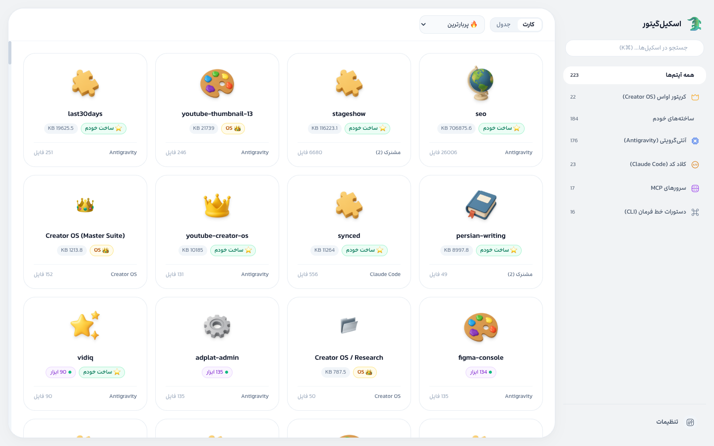
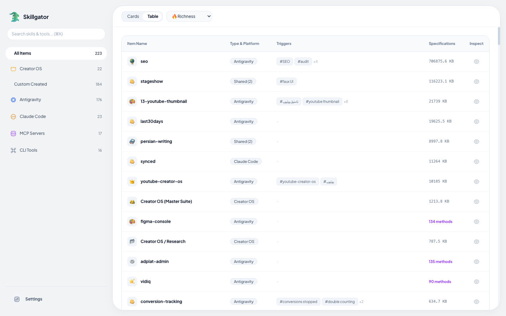
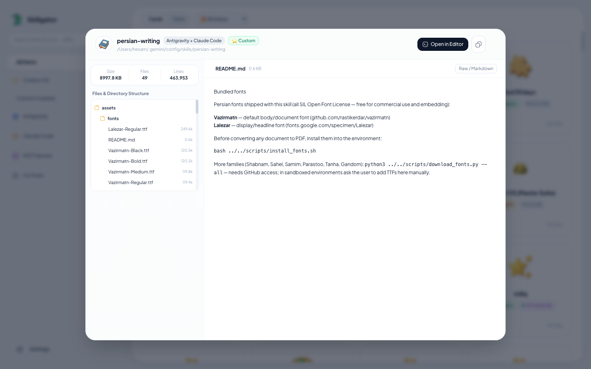

# 🐊 Skillgator — Universal AI Agent & Skills Radar

<div align="center">



<p align="center">
  <strong>The open-source, zero-config real-time dashboard for discovering, inspecting, and managing AI Skills, MCP Servers, and Agent Tools.</strong>
</p>

[](https://www.python.org/)
[](https://opensource.org/licenses/MIT)
[](https://antigravity.google)
[](https://claude.ai)
[](https://cursor.com)

[English](#-english) • [فارسی](#-فارسی-persian)

---

</div>

<a name="-english"></a>
## 🌐 English

**Skillgator** is a modern, lightweight, and local AI agent management cockpit designed for engineers, creators, and solo makers working with **Google Antigravity**, **Claude Code / Desktop**, **Cursor**, **Windsurf**, and custom toolkits.

Without any database or complex setup, Skillgator auto-scans your filesystem in real-time, extracts keywords & triggers, inspects full directory structures, and provides a sleek floating canvas interface inspired by Linear and Raycast.

### ✨ Key Features

- **⚡ Zero-Config Auto-Discovery:** Instant detection of Skills, MCP Servers, Rules, and CLI binaries from standard system paths (`~/.gemini`, `~/.claude`, `~/.cursor`).
- **🎛️ Dual-View Architecture:** Switch seamlessly between an **Apple-style 3D Card Grid** and a compact, high-density **Table View**.
- **🔬 Deep Skill Inspector & Directory Tree:** Click any skill to explore its recursive folder tree (`scripts/`, `references/`, `assets/`) and render rich `SKILL.md` documents directly in your browser.
- **🔌 MCP Tool Explorer:** Examine schemas, parameters, and descriptions for all lazy & eager Model Context Protocol (MCP) servers.
- **🔍 Fast Command Palette (`⌘K` / `Ctrl+K`):** Instantly search across skill names, descriptions, tools, and trigger words without breaking focus.
- **📡 Real-Time SSE Stream:** Changes to files, new skills, or updated configurations reflect live in the dashboard without manual browser refreshing.
- **🌍 Bilingual & Bidirectional:** 1-click switcher between **English (LTR)** and **Persian (RTL)** with native typography (`Plus Jakarta Sans` & `Digikala`).
- **💻 One-Click IDE Launch:** Open any skill or config file directly in your active code editor (`open -a Antigravity` / VS Code).

---

### 📸 Screenshots

| Grid View (Apple / Linear Canvas) | High-Density Table View |
| :---: | :---: |
|  |  |

| Deep Skill Inspector & Live Markdown Viewer |
| :---: |
|  |

---

### 🚀 Quick Start

Skillgator runs out of the box with zero external dependencies (pure Python standard library):

```bash
# 1. Clone repository
git clone https://github.com/Hesvm/skillgator.git
cd skillgator

# 2. Run local monitor server
python3 server.py
```

Now open **[http://localhost:4949](http://localhost:4949)** in your favorite browser.

#### Optional: Run in Background on macOS
```bash
nohup python3 server.py > /tmp/skillgator.log 2>&1 &
```

---

<a name="-فارسی-persian"></a>
## 🇮🇷 فارسی (Persian)

**اسکیل‌گیتور (Skillgator)** یک داشبورد مدرن، لوکال و بدون نیاز به کانفیگ برای پایش، کاوش و مدیریت اکوسیستم اسکیل‌ها و ابزارهای هوش مصنوعی (Google Antigravity, Claude Code, Cursor, Windsurf و MCP Server) است.

### 🌟 قابلیت‌های برجسته

۱. **شناسایی خودکار و بدون پیکربندی (Zero-Config):** شناسایی آنی کلیه اسکیل‌ها، متدهای سرورهای MCP، دستورات CLI و رول‌ها در سیستم شما بدون نیاز به دیتابیس یا تنظیمات دستی.  
۲. **رابط کاربری شناور و مینیمال (Linear & Apple Style):** فریم شناور فوق‌العاده زیبا با طراحی تمیز کارت‌های سه‌بعدی و نمای جدولی فشرده.  
۳. **کالبدشکافی کامل اسکیل‌ها و درخت پوشه‌ها (Skill Inspector):** نمایش ساختار فایل‌ها، پوشه‌های داخلی (`references/`، `scripts/`، `assets/`) و رندر زنده اسناد `SKILL.md` با پشتیبانی از کدهای خام و Markdown.  
۴. **کاوشگر ابزارهای MCP:** مشاهده نام متدها، پارامترهای ورودی و اسکیما (`inputSchema`) برای تمامی سرورهای MCP متصل.  
۵. **پالت جستجوی سریع (`⌘K`):** جستجوی درلحظه میان نام‌ها، کلمات کلیدی، تریگرهای فعال‌ساز و ابزارها.  
۶. **پایش زنده و بدون وقفه (Server-Sent Events):** تغییر در فایل‌ها یا ساخت اسکیل جدید به طور خودکار و بدون نیاز به رفرش در صفحه نمایش داده می‌شود.  
۷. **پشتیبانی کامل دو زبانه (فارسی / English):** سوییچ فوری بین حالت راست‌چین (RTL با فونت دیجی‌کالا) و چپ‌چین (LTR با فونت Plus Jakarta Sans).

---

### 💻 نحوه اجرا

```bash
# کلون ریپازیتوری
git clone https://github.com/Hesvm/skillgator.git
cd skillgator

# اجرای سرور لوکال
python3 server.py
```

آدرس داشبورد در مرورگر: **`http://localhost:4949`**

---

### 🛠️ معماری پروژه (Architecture)

- **Backend:** سبک‌ترین سرور پایتون مبتنی بر `http.server` با پشتیبانی از چندنخی (Multi-threading) و استریم زنده `SSE`.
- **Frontend:** طراحی بدون فریم‌ورک با HTML5 مدرن، Tailwind CSS، موتور رندر `marked.js` و فونت‌های بهینه‌سازی‌شده وب.
- **Portability:** صد درصد سازگار با macOS، Linux و Windows با تشخیص داینامیک مسیر کاربر (`Path.home()`).

---

### 📄 License

This project is open-source and available under the [MIT License](LICENSE).
Contributed with ❤️ by [Hesam](https://github.com/Hesvm).
